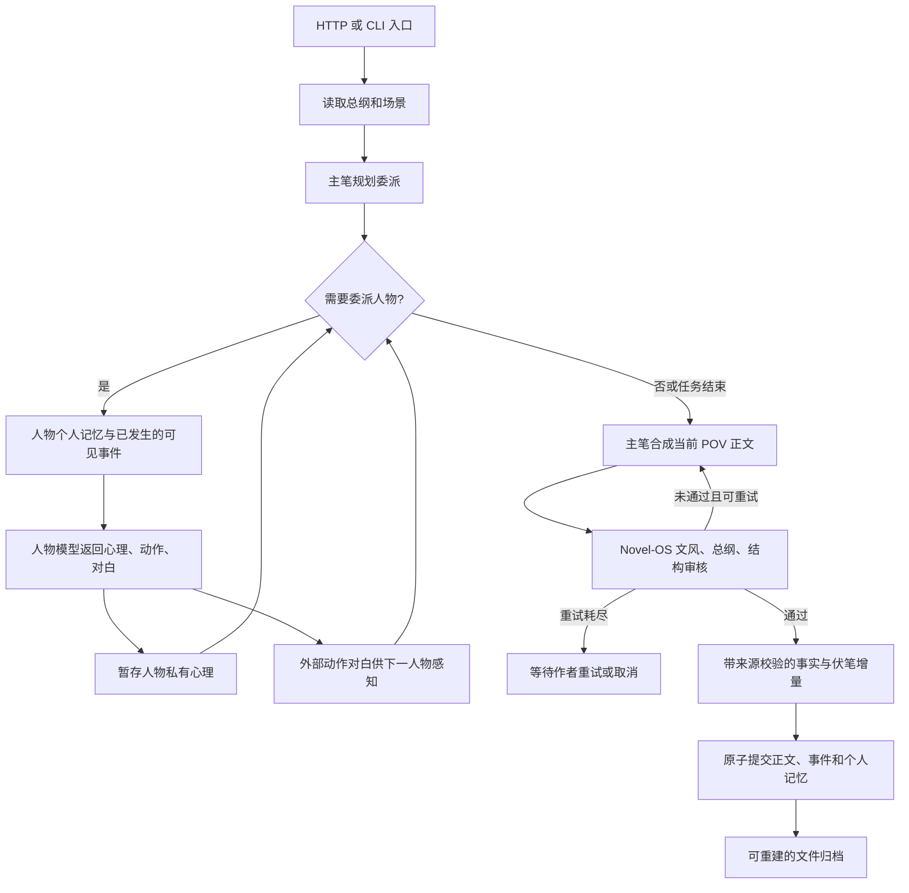

# 单视角小说 Agent

独立 Python / LangGraph 项目，按“API 入口 → 大纲 → 主笔 → 人物委派 → 心理/外部表现 → 主笔 → 审核”运行。
模型调用通过 OpenAI-compatible `/chat/completions`，可以给主笔、人物、审核配置不同模型。
人物心理和主观记忆分别落盘；正文只使用当前视角人物的心理。

## 快速运行（Windows PowerShell）

本项目目录：`D:\workspace\novel`。已准备项目内虚拟环境和离线演示。

```powershell
cd D:\workspace\novel
.\.venv\Scripts\python.exe -m pov_novel demo --project projects\demo --mock
Get-Content projects\demo\manuscript\book.md -Encoding UTF8
```

`--mock` 只验证执行流程，输出和评分是确定性的演示，不代表真实模型的文学水平。
重复运行同一个已接受场景直接返回归档结果，不重复追加正文或角色记忆。

新机器安装：

```powershell
python -m venv .venv
.\.venv\Scripts\python.exe -m pip install -r requirements-lock.txt
.\.venv\Scripts\python.exe -m pip install -e . --no-deps --no-build-isolation
```

## 接入真实模型 API

复制 `.env.example` 为 `.env`，填写端点、可用模型名称和密钥。可以使用 `OPENAI_API_KEY`，
也可以填 `NOVEL_API_KEY`。本程序不会打印密钥，不将密钥写入小说设定。
其他供应商应提供 OpenAI-compatible 接口；原生 Anthropic Messages 等接口需要另加适配器。

```powershell
Copy-Item .env.example .env
# 编辑 .env：NOVEL_API_BASE_URL、NOVEL_MODEL、NOVEL_API_KEY
.\.venv\Scripts\python.exe -m pov_novel init --project projects\mybook --story examples\story
.\.venv\Scripts\python.exe -m pov_novel run --project projects\mybook --scene examples\scene.json
```

设定分别保存，先编辑 `examples/story/` 中的文件，再编辑 `examples/scene.json`：

| 文件 | 内容 |
|---|---|
| `project.json` | 小说名称和人物 ID 列表，仅作索引，不包含人物卡内容 |
| `outline.json` | 总纲，格式为 `{"outline":"总纲内容"}` |
| `style.json` | 文风，格式为 `{"style":"文风要求"}` |
| `reference.json` | 参考正文，格式为 `{"style_sample":"参考正文"}` |
| `characters/linmo/card.json` | 林墨人物卡 |
| `characters/chuyao/card.json` | 楚瑶人物卡，每个人物独立一个文件 |

`init` 将这些独立文件复制到 `projects/mybook/`。初始化后，直接修改该项目里的
`outline.json`、`style.json`、`reference.json` 和各人物的 `card.json`，下一次启动写作时会读取修改。
不要再编辑示例文件来修改已创建的小说。新增人物需要创建 `characters/<id>/card.json`，
并将 ID 加入 `project.json` 的 `characters` 列表；列表顺序用于保持人物顺序。
修改设定后使用新的场景 ID，已完成正文和个人记忆保留；未完成任务不能在设定改变后接续。

旧项目可以迁移，旧合并文件备份到 `.runtime/legacy-story.json`，不改变已归档场景或记忆：

```powershell
.\.venv\Scripts\python.exe -m pov_novel migrate --project projects\mybook
```

程序仅在内存中组合独立文件以验证和生成模型输入，不再把它们合并落盘成 `story.json`。
`.env` 从启动目录读取；也可以用 `--env D:\path\model.env` 指定。
模型需能输出符合 Schema 的 JSON。供应商不支持 `response_format` 时设置 `NOVEL_JSON_MODE=off`；
需要 `max_completion_tokens` 的模型设置 `NOVEL_TOKEN_FIELD=max_completion_tokens`。
默认不传 temperature；可按端点支持情况显式配置。

更换模型后请使用新的未完成场景 ID；已归档场景重复运行仍读取原成果。全书事件 ID 必须唯一。

## 从已有小说自动提取设定

支持 TXT / Markdown 单文件和按章保存的目录。复用 [InkOS 导入方法](https://github.com/Narcooo/inkos/blob/8fc2ae57080b9821257dee3e37cc677e2b6f389a/packages/core/skills/inkos-story-import/SKILL.md)、
重建规则和分章逻辑，移植为 Python 并适配本项目的独立 JSON。原文逐章、逐段完整读取，
不会只取开头；中文章/回、英文 Chapter 和罗马数字标题均可识别。目录按文件名数字自然排序。

```powershell
# 先配置 .env 中的真实模型，再执行；会按片段调用模型 API
.\.venv\Scripts\python.exe -m pov_novel import-novel --project projects\mybook --source D:\books\已有小说.txt --title "我的小说"
# GBK/GB18030 编码的老 TXT 加 --encoding gb18030
# 文件目录也支持：--source D:\books\已写章节

# 离线演示，只验证执行和文件结构
.\.venv\Scripts\python.exe -m pov_novel import-novel --project projects\import-demo --source examples\existing_novel.txt --title "导入演示" --mock
```

生成 `project.json`、`outline.json`（已发生剧情和未解决主线，不杜撰后续）、`style.json`、
`reference.json`（直接截取原文）、`characters/<id>/card.json` 和独立个人记忆。
另存 `world.json`、`relationships.json`、`timeline.json`、`hooks.json`、`import-report.json` 和分章原文。
这些 JSON 已接入规划、状态结算和审核。`hooks.json`、`timeline.json`、`relationships.json`、
`world.json` 是可重建的实时投影；导入原始分析保存在归档记录的 `author_material`，
旧项目首次重建时备份至 `imports/foundation/author_material.json`。不要直接编辑实时投影来修改正典。
导入记录包含每章结构化摘要，后续场景归档自己的摘要、事实与伏笔增量；私有事实不会自动进入人物上下文。

导入正文保留在正式手稿中，后续场景接在它后面。人物知识只按正文明确支持的个人见闻、
私有经历或判断生成；推测保留为 belief，读者已知事实不自动分发给所有角色。
模型提供的证据原句必须能在当前片段中找到；语义归属和文学分析仍需作者检查。
矛盾、未明确内容、缺章与安全续写位置记录在 `import-report.json`，不凭空填补。
新增人物 ID 可在 `project.json` 中查看；续写时使用新场景 ID，并据此设置 POV 和在场人物。

首次导入需要一个新的小说项目。未完成导入时可以直接修改来源正文并重跑同一命令：
程序逐段核对已完成片段，删除或改动尚未读取的后面章节时复用已有结果；
若改动已读取的正文，则保留一致前缀，从首个变化处回退并重新提取人物状态和记忆。
旧来源快照和进度记录保存在 `.runtime/import/originals_history/` 与 `binding_history/`。
已完成导入并进入续写的项目仍需要新项目目录，以保护正式手稿和作者修改。
调整输出额度、片段大小或上下文预算不再使未完成导入失效；更换模型服务或模型名称仍保留进度并要求恢复原配置。
同一小说成功导入后再次执行返回原结果，不重复追加正文或记忆。

可用 `NOVEL_IMPORTER_MODEL` 单独设置提取模型，`--chunk-size` 控制单次读取字符数，默认 6000。
`--max-parts 3` 表示本次最多提取 3 个新片段，方便试运行；去掉它继续全量导入。
`--context-budget` 默认 60000，按 UTF-8 字节保守估计，另预留输出和系统提示的空间。

上下文管理移植自 InkOS 的 semantic-input、context-compiler 和 semantic-context-compiler：
当前原文、人物身份和当前审核条件属于 protected，保持完整；历史总纲、文风和相关人物旧资料
属于 compressible，超过预算时由模型压缩，保留实体、未解问题、因果约束和来源 ID。
压缩输入分块完整读取，人物旧记忆独立压缩，不混入其他人物的私有资料。
编译预算与来源记录在 `.runtime/import/context_traces/`，原始提取依据保留在 `traces/`。
写作时个人记忆也使用同一压缩器，审核前文使用同一上下文编译器。

记忆压缩若返回超过 30 条候选，先逐条校验全部候选的 ID、来源和类型，再按模型给出的顺序
保留预算内的条目；原观察由程序复制，主观摘要保持为 belief。超额候选及输入记忆保存在
`model_cache/memory_budget_repairs/`，错误 ID 不能借超额恢复绕过校验。
人物提取只提交新增别称，已登记别称留在原人物资料中；超额输出重复已有别称时可恢复为增量，
新增别称超限仍要求修复。代词、自称及通用称谓不能作为跨片段的唯一身份键。
具名人物的别称与其他卡片冲突时，不登记该别称，并保留待确认说明；无法唯一归属的更新
经过三次修复仍失败时，完整候选保存到作者待确认记录，不写入任何人物的私有记忆。
旧提取记录按记录生成时的身份契约重放，已完成的正文前缀不因规则更新而重新调用模型。
全书人物库不再限制 50 人，人物卡的累计私密事实也不限于 30 条；
每片段的提取上限、每个场景的参与人数上限和运行时上下文预算继续生效。
引文只允许恢复排版空白，或移除模型在逐字摘录外额外添加的一对引号；恢复结果必须是当前正文
中的连续原句，不修复内部措辞、标点或省略号。恢复前后及来源偏移保存在 `quote_repairs/`。
DeepSeek 官方返回 HTTP 402 表示账户余额不足；在服务商平台恢复额度后重跑原命令即可复用断点，
无需删除项目或更改模型配置。

单文件导入的来源完整性和已完成提取记录可以离线复核，不调用模型 API：

```powershell
.\.venv\Scripts\python.exe scripts\verify_full_import.py --project projects\mybook --source D:\books\已有小说.txt --partial
# 完整导入结束后去掉 --partial，额外验证正式正文和每章摘要投影。
```

遇到 API 明确报告输出截断，会按 6000 → 12000 → 24000 自动提高额度重试（从配置值起，最多 3 次）；
如果依然截断，则把未完成的原文片段无损拆小再提取，不接受半截 JSON。
提取等结构化调用保留这个 JSON 恢复方式。主笔正文使用纯文本调用，只有服务明确返回
`finish_reason=length` 才续接：回传完整已生成正文，要求从停止处继续，再合并最多 4096 字符的精确重叠。
`NOVEL_MAX_CONTINUATIONS` 默认 3；超限、拒答或网络错误均不接受半成品。
不完整正文保存在私有缓存的 `*.partial.json`，不会进入手稿和人物记忆。正文模型不再有 16000 字符的 Schema 上限，
但仍需在配置的上下文窗口内完成写作与审核。
`NOVEL_MAX_OUTPUT_TOKENS_CEILING` 控制最高额度，默认至少 24000；可按模型支持范围调整。
`NOVEL_CONTEXT_WINDOW` 默认 131072，用于预留输入空间。
提取输出格式不合规时，最多进行 3 次生成/修复尝试，将前次失败结果和字段错误交给模型修正。
性格、声音、目标仍需带 text/quote，证据原句仍逐字核对，不会自动给无证据描述补原文。
模型引文仅有换行或缩进差异时，程序定位并恢复完整原文片段再逐字核对；不改标点、词语或 ASCII 单词边界，修正记录保存在 `.runtime/import/quote_repairs/`。
作者层面的事实支持可选 confidence（low/medium/high），保留在带来源的 JSON 中。
失败输出保存在 `.runtime/import/format_failures/`，超过输入预算时仅用于作者追溯。
若格式修复仍失败，自动无损拆小当前片段再提取；最小片段失败时保留进度并停止。
引文失败会返回具体字段路径，三次修复仍失败则无损拆小片段；拆分在字节预算允许时平衡过短的尾片段。
人物姓名核对也使用已登记别称，模型无需在每次输出中重复已有别称。仅有代词而无法归属的人物更新先重试修复；
三次后仍无法确认身份、且所有引文已经逐字通过的候选保存在 `.runtime/import/identity_uncertainties/`，
并记入该片段及最终 `import-report.json` 的 uncertainties，其他有依据的内容继续提取。
候选不写入人物卡或个人记忆；虚构引文和多个人物同时匹配的身份冲突仍拒绝提交。
进度中的分母表示正文片段数；自动拆分会增加分母，不表示小说多出了章节。
DeepSeek 官方接口的提取、记忆和上下文编译默认关闭 thinking；可用 `NOVEL_THINKING=enabled` 显式开启。
这三个角色用于结构化资料处理；主笔和审核保持模型的默认模式。
`--mock` 只有演示样本人物的确定性提取，不能用来分析任意真实小说。

InkOS 原始文件、固定提交和 SHA-256 保存于 `vendor/inkos/`。本项目复用了 AGPL-3.0 内容，
项目许可证见 `LICENSE`；Novel-OS 提示词继续保留 MIT 许可证。详见 `THIRD_PARTY_NOTICES.md`。

## 工作流



主笔使用完整作者设定来决定委派；角色模型接收的输入经过程序组装，没有共享聊天历史、
其他角色卡、私密心理、总纲、场景目标或未来事件，也没有文件读写工具。
角色只能通过已经看到的公开动作和对白推测别人。客观事件也按 `visible_to` 判断是否可见。
角色任务按事件顺序执行，后一人物可以看见前一人物已经产生的外部反应。

正文合成接收场景目标、作者意图和经过过滤的总纲片段，以及 POV 自己的主观记忆。
总纲中包含其他人物秘密关键词的句子会被保守排除；完整总纲仍由规划和审核使用。
关键词过滤不等于语义证明。作者应将 `goal`、`intentional_choices` 和参考正文写成可以指导当前叙述的内容。

`plan` 可以省略，让主笔自动生成任务；也可以手动给出。
`plan: {"tasks": []}` 表示不委派，直接让主笔写可见素材。
任务的 `character_id: null` 表示跳过该次人物委派。
`need_psychology: false` 表示该任务不生成心理正文。
非 POV 人物也可以生成后台心理，但不会进入正文模型的初次写作输入。

角色卡里的 `known_secrets` 必须是角色自己已知的秘密，不要放作者预设的未来转折。
场景 `setting` 必须是可公开感知的环境，不能夹带隐秘真相；隐秘事件放在 events，正确填写 visible_to。

## 审核：复用 Novel-OS

复用了 [Novel-OS](https://github.com/mrigankad/Novel-OS) 的三份原始提示词，保存在
`src/pov_novel/vendor/novel_os/`，包含 MIT 许可证、固定 commit 和逐文件 SHA-256。

| 审核角色 | 用途 |
|---|---|
| Style Curator | 文风、叙述距离、句式节奏、用词、口吻 |
| Continuity Guardian | 总纲、场景目标、情节红线、事件一致性 |
| Editor | 场景结构、节奏、推进，提供 developmental 建议 |

适配层保留上游的审核方法，替换 Markdown / STATE_UPDATE 输出格式为 Pydantic 验证的 JSON。
Style Curator 保留 consistency/genre/voice 三个分数，三项默认都至少 7；
Continuity Guardian 返回 PASS/WARNING/FAIL，FAIL 阻塞；Editor 对实际上一版和当前版给出
before_quality/after_quality，首次 before_quality 为 null，当前版默认至少 7。
未豁免的 major/critical 问题都阻塞。位置、严重程度和建议保留在作者审核报告中。
所有问题必须给出 `source_refs: [{source_id, quote}]`：来源必须属于本次输入，quote 必须是
该来源连续逐字原文。格式或证据错误最多重试三次，不会静默当作通过。
作者私密来源的问题不会传给正文合成；合成反馈只包含可见来源的精确引文、位置和严重程度。
这不是将 Novel-OS 整个平台移植过来；本项目提供自己的文件状态与确定性检查实现。
审核质量取决于模型、总纲和样例，未声称优于其他审核器。

作者可以用 `intentional_choices` 声明“这个误解是故意的”等意图。
审核失败只重写主笔正文，已生成的角色反应暂存，不会把全知审稿意见交给人物模型。
默认最多重写 2 次，然后通过 LangGraph interrupt 停下来；未通过的场景不进入正式记忆或正文。

```powershell
.\.venv\Scripts\python.exe -m pov_novel status --project projects\mybook --scene-id chapter01_scene01
.\.venv\Scripts\python.exe -m pov_novel resume --project projects\mybook --scene-id chapter01_scene01 --action retry
# 或 --action cancel
```

普通网络失败或进程中断后，重新执行原 `run` 命令，从 SQLite checkpoint 恢复。
不要在恢复之前先归档另一个场景：旧任务绑定其启动时的前文版本，前文变更后会要求新场景 ID。

## 文件和记忆

```text
projects/mybook/
├── project.json        # 名称、人物 ID 索引
├── outline.json        # 总纲
├── style.json          # 文风
├── reference.json      # 参考正文
├── characters/<id>/
│   ├── card.json
│   ├── memory.json
│   ├── drafts/<task-id>-attemptN.json  # 合成正文之前已保存的个人草稿
│   └── private_logs/<task-id>.json
├── scenes/<scene-id>/
│   ├── request.json / plan.json / status.json
│   ├── tasks/       # 作者可查看人物收到什么、生成什么
│   ├── drafts/      # 每轮主笔正文
│   ├── reviews/     # 每轮三份审核报告
│   └── accepted.json
├── world/events/<scene-id>.json
├── manuscript/<scene-id>.md / book.md
└── .runtime/model_cache/ / checkpoints.sqlite
```

个人记忆区分 `observation`（见闻）与 `belief`（主观判断），保留来源 ID 和确信程度。
超过近期条目数或上下文预算时，只把该人物的旧记忆交给压缩模型，保留近期原文。
程序拒绝新增未知来源和把推测改写成见闻。原始心理日志继续保留，可追溯。
压缩时模型对见闻只选择 `retained_ids`，由宿主复制原始文本、类型、证据与确信程度；
模型不能重新生成或润色 observation。主观判断可以带已有条目 ID 合并，但宿主强制仍为 belief，
证据由原条目计算，格式或 ID 错误有三次带反馈修复，拒绝完全清空非空记忆。
个人状态（情绪、目标）和摘要随着后续场景递进；角色记忆版本每接受一个场景增长一次。
第一版按 UTF-8 字节保守估计 token 上限；预算不足会明确停止，不静默截断重要经历。

`accepted.json` 是单个场景的原子提交点。正文、世界事件、个人日志和 memory.json
都可以从接受记录重建。项目使用操作系统文件锁，禁止同一本小说同时提交两个写作任务。
SQLite 保存执行 checkpoint 和可重建的 FTS5 索引，没有向量检索；真相仍是可读 JSON / Markdown。
检索使用中文相邻双字、BM25（标题权重 5），由模型在候选中选择场景 ID，宿主拒绝越界和重复 ID。
规划/审核可检索作者资料，正文只接收 POV 已见事件，人物模型仍只读取自己的记忆。
索引按替换方式重建，导入恢复不会追加重复条目。

设置文件集合和每段导入的 trace/checkpoint 通过暂存、备份、fsync journal、rename 提交；
普通异常回滚，进程死亡后由下一位取得项目锁的进程恢复。多路径 rename 不是操作系统的瞬时原子操作，
一致读取需要遵守项目锁；外部编辑器仍由作者控制。Windows 进行文件 fsync，目录 fsync 仅用于支持的平台。
`project.json`、memory、binding 和新归档有 `schema_version: 2`；旧的无版本文件继续读取，未来未知版本明确拒绝。
`memory.version` 仍表示记忆递进次数，与格式版本分开。

模型调用缓存包含私密创作数据；它和任务输入、checkpoint 都是作者后台资料，不要拿来当公共网页文件目录。
程序能隔离输入，不能数学保证模型不会自行猜中秘密或审稿不会漏检。真实模型的文学质量需另行评测。

## HTTP API 网关

```powershell
.\.venv\Scripts\python.exe -m pov_novel serve --projects-dir projects --port 8765 --mock
# 接真实模型时去掉 --mock
```

绑定 `127.0.0.1`，仅供本机作者使用。这个版本没有用户账号和公网鉴权。

| 请求 | 用途 |
|---|---|
| GET /health | 健康检查 |
| POST /projects/{id} | body 为 StoryConfig，创建小说并拆分保存为独立文件 |
| POST /projects/{id}/scenes | body 为 SceneSpec，执行场景 |
| GET /projects/{id}/scenes/{scene} | 查看执行状态 |
| POST /projects/{id}/scenes/{scene}/resume | body 为 `{"action":"retry"}` 或 `{"action":"cancel"}` |
| GET /projects/{id}/manuscript | 读取正文 |
| GET /projects/{id}/state | 作者故事状态、伏笔、位置和关系 |
| GET /projects/{id}/search?q=查询&pov=人物ID | 检索；省略 pov 是作者视图 |
| GET /projects/{id}/settings | 持久豁免和技能设置 |
| POST /projects/{id}/dismissals | `{"key":"category:entity_id","reason":"原因"}`；取消加 `"restore":true` |
| GET /projects/{id}/skills | 技能及引用文件的 SHA-256 |

场景写作请求会等待执行结果，实际模型可能需要数分钟；状态接口可同时查询。
等待作者处理时返回 HTTP 202；同项目另有任务时返回 409；模型连接失败返回 502。

## 验证

```powershell
.\.venv\Scripts\python.exe -m unittest discover -s tests -v
```

覆盖信息隔离、未来事件、单视角合成、跨场景个人记忆、记忆压缩、文风失败重写、
重试耗尽后的持久化暂停、API 请求契约、HTTP 入口和提交中断后的无重复恢复。
没有配置真实 API 密钥时，只验证离线模型和模拟 HTTP transport，不宣称真实模型审核已通过。

## 状态、豁免、技能与无密钥开发

```powershell
.\.venv\Scripts\python.exe -m pov_novel state --project projects\mybook
.\.venv\Scripts\python.exe -m pov_novel search --project projects\mybook --query "旧信与渡口"
.\.venv\Scripts\python.exe -m pov_novel reindex --project projects\mybook
.\.venv\Scripts\python.exe -m pov_novel dismiss --project projects\mybook --key overdue_hook:hook-实际ID --reason "第三卷才回收"
# --restore 取消该豁免；稳定键不随提示措辞或章节号改变
.\.venv\Scripts\python.exe -m pov_novel run --project projects\mybook --scene examples\scene.json --dry-run
.\.venv\Scripts\python.exe -m pov_novel run --project projects\mybook --scene examples\scene.json --draft-file 我的草稿.md
.\.venv\Scripts\python.exe -m pov_novel export --project projects\mybook --output projects\mybook\exports\book.md --reject-all
```

`state` 读取归档事实，`reindex` 无模型调用地重建投影。已经导入的旧项目也可重建每章摘要。
只完成一部分的导入项目应继续原 `import-novel` 命令，不对未完成提取执行 `reindex`。
确定性检查包括伏笔超期、久未出场、同章关系三元组冲突、任务/事件执行覆盖、人物卡字段和正文长度。
它们不能证明场景目标在文学意义上已经达成。字数剥离 Markdown 标题/围栏并按非空白字符计数；
默认只记录 telemetry，SceneSpec 显式填写 `min_characters`/`max_characters` 后才阻塞。
可选 `chapter` 指定章号；同章可有多个场景，不能追加到已经归档的更早章节。
`settings.json` 可设置 `absent_after`（默认 10）、`dismissals`、`genre` 和 `skills`。
豁免在引擎中执行，审核提示和 HTTP/CLI 使用同一套决定；因此可以登记豁免后 `resume --action retry`。

应用技能是静态方法文档。将 `examples/skills/mystery/` 复制到项目 `skills/mystery/`，
或放在用户 `~/.pov-novel/skills/`（可用 `NOVEL_USER_SKILLS_DIR` 改位置）。
SKILL.md 使用 YAML frontmatter：`id`、`roles: [writer, style]`、`genres: [悬疑]`、
`references: [references/clues.md]`。引用只允许技能目录内的 Markdown，项目同 ID 优先。
`--skill @mystery` 强制启用，`--skill=-@mystery` 禁用；也可设置 `settings.json` 的
`"skills":{"mystery":true}`，或通过 genre 自动匹配。`skills` 命令列出 SHA-256，执行时保存激活记录。
技能不能注入人物模型、执行脚本或覆盖正典/格式/权限；生效技能内容变化会拒绝恢复旧任务。

`--dry-run [输出.json]` 不需要模型或密钥，落盘组装后的提示；后续提示使用标明的演示人物输出，
可加 `--draft-file` 预览真实人工正文的审核提示。默认落盘 `.runtime/dry_run/`，不提交原项目新场景。
导入也支持 `--dry-run`，预览第一正文片段；后续上下文依赖前序真实提取。
`--draft-file` 只替代第一轮正文，随后仍使用相同证据闸门、审核、状态结算和归档。
阶段产物记录 produced_by、reviewed_by、reviewed_at，依次 proposed → in_review → final；
新归档在 `accepted.json.stage_artifacts` 记录规划、人物任务、正文、审核、状态结算和最终个人记忆，
并投影至 `scenes/<id>/artifacts/stages/`；人工草稿来源标为 author，宿主记忆更新不冒充模型生成。
导出与下一轮故事检索始终只使用 final，`--reject-all` 显式表达这个投影视图。

## 模型配置扩展

已有显式 NOVEL_API_BASE_URL/NOVEL_MODEL/NOVEL_API_KEY 优先且保持原值。
可选择 `NOVEL_PROVIDER=deepseek`，只填 `DEEPSEEK_API_KEY`；默认模型 `deepseek-flash`，
端点见 [DeepSeek 官方文档](https://api-docs.deepseek.com/)。`custom` 别名默认本机 8000/v1，模型需自己填写。
新增 `NOVEL_STATE_MODEL` 和 `NOVEL_RETRIEVAL_MODEL`，默认使用 NOVEL_MODEL。
默认不传 temperature；可分别设置 `NOVEL_CREATIVE_TEMPERATURE`、`NOVEL_STATE_TEMPERATURE`、
`NOVEL_REVIEW_TEMPERATURE`，最后回退 NOVEL_TEMPERATURE。供应商和模型须支持所传参数。

`--backend cli` 或 `NOVEL_BACKEND=cli` 启用通用 CLI 后端。`NOVEL_CLI_COMMAND` 是文字 argv JSON 数组，
例如 `["你的模型CLI","非交互子命令"]`，具体参数由所用 CLI 决定；程序不拼接 shell 命令。
完整提示走 stdin，stdout 必须只返回指定 JSON；加非交互前言，有超时与三次退避重试。
CLI 的登录、模型设置、订阅额度和费用取决于供应商，程序不承诺免费，也不支持会自动执行工具的任意交互模式。

离线 CI 使用 Windows/Linux、Python 3.11/3.12/3.13 矩阵，无需 API Key。
工作流使用官方 [checkout](https://github.com/actions/checkout) 和 [setup-python](https://github.com/actions/setup-python) 的 v7 接口。
显式真实 API 验证可运行 `scripts/verify_live.py --live --output projects/live-check`；
这会对独立演示项目写作和导入，不修改 mybook，产生正常供应商调用费用。
完整落实范围见 [IMPLEMENTATION_REPORT.md](IMPLEMENTATION_REPORT.md)。
